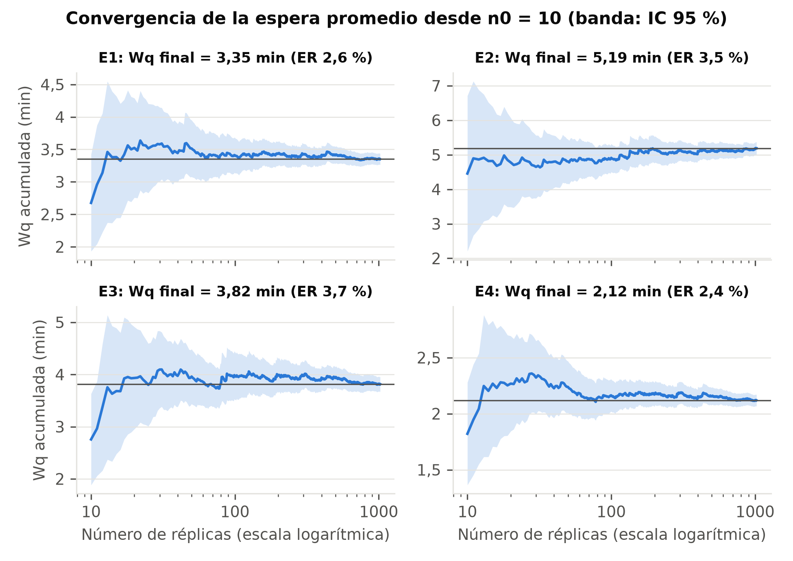
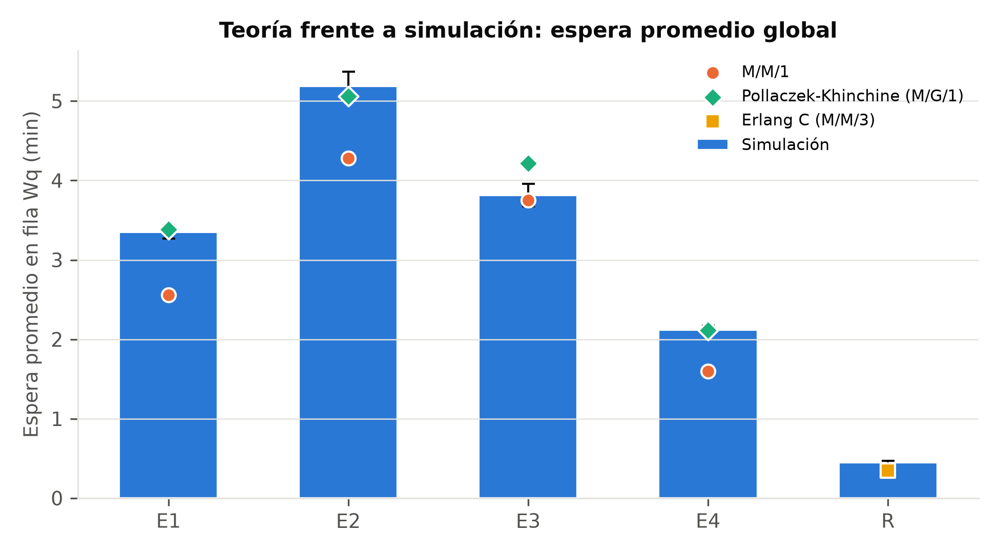
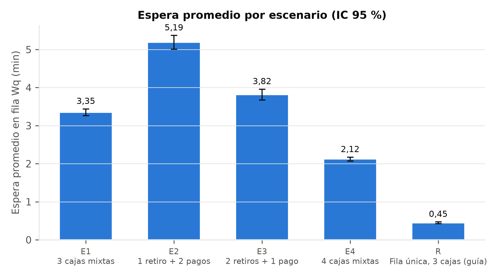
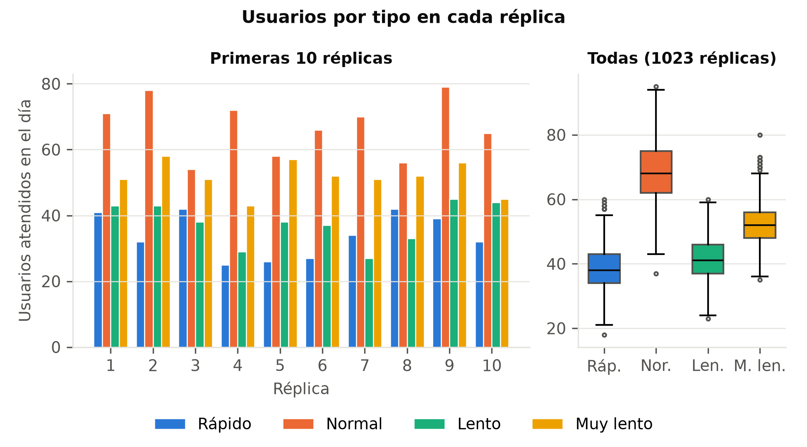
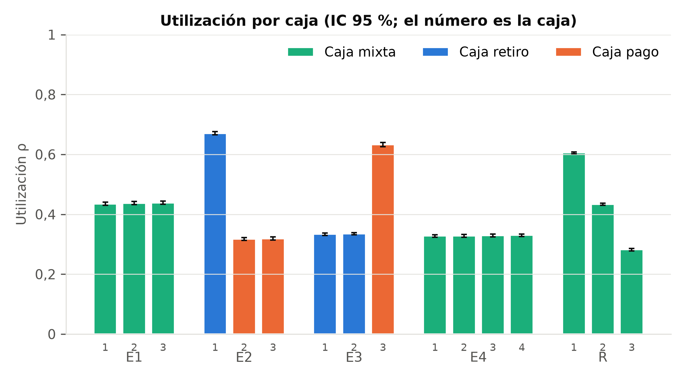
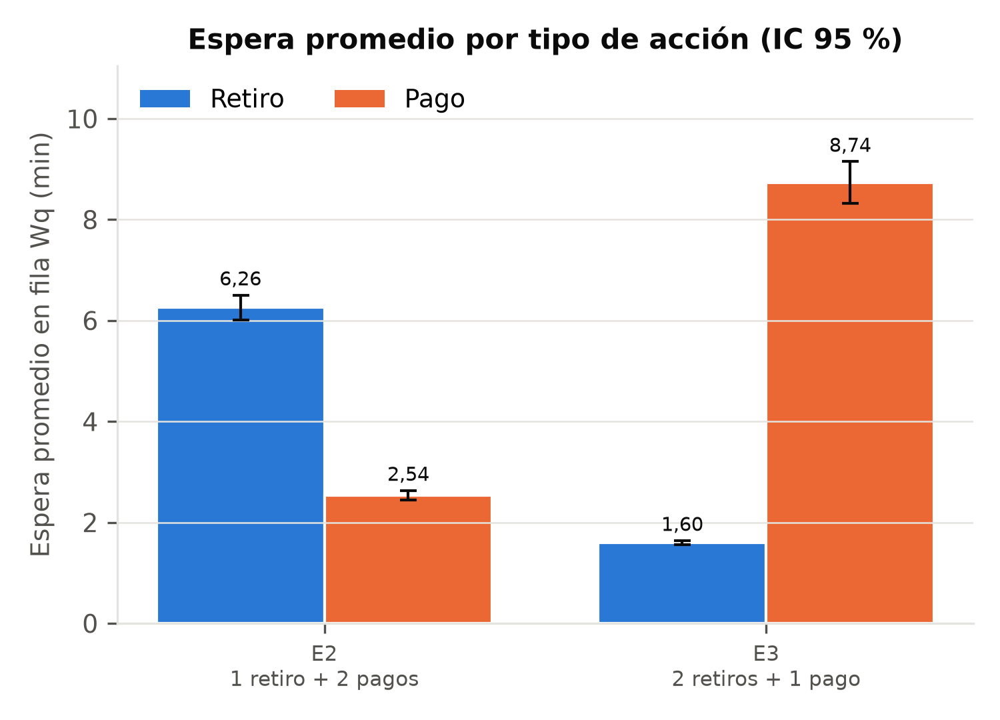

# Problema bancario: simulación de cajas con colas M/M/1

Actividad didáctica 2-M3 del curso Simulación (PREICA2602B020045), Institución Universitaria Digital de Antioquia.
Autora: Hanna Jineth Contreras Salinas. Docente: Julián Andrés Loaiza López.

Video de presentación: [ver en Google Drive](https://drive.google.com/file/d/1796Po7qIxjJvQvvqSymQhFK30A4_8PQX/view?usp=sharing)

## El problema

Un banco tiene 3 cajas que atienden retiros (70 % de los clientes) y pagos (30 %) durante 8 horas al día, y quiere saber si le conviene dejar 1 caja exclusiva para retiros y 2 para pagos, o al revés. Cada caja se modela como una cola M/M/1. Con al menos 10 réplicas hay que responder:

- **P1.** Qué caja tiene el menor y el mayor tiempo promedio de atención.
- **P2.** El promedio de usuarios de cada tipo en el total de cajas.
- **P3.** El total de usuarios de cada tipo en cada réplica y cuál réplica tiene menos.
- **P4.** Si hace falta una caja nueva, según los tiempos promedio de espera.
- **P5.** Cuántas cajas deben ser exclusivas para pagos y cuántas para retiros.

Datos (minutos, distribución exponencial):

| Acción | Tipo | Probabilidad del tipo | Media de servicio | Media de llegada |
|---|---|---|---|---|
| Retiro (70 %) | Rápido | 0,23 | 1 | 1 |
| | Normal | 0,40 | 2 | 2 |
| | Lento | 0,17 | 3 | 3 |
| | Muy lento | 0,20 | 4 | 3 |
| Pago (30 %) | Rápido | 0,10 | 3 | 1 |
| | Normal | 0,20 | 3 | 2 |
| | Lento | 0,30 | 5 | 3 |
| | Muy lento | 0,40 | 7 | 4 |

## Supuestos

**Una sola fila de llegadas.** Seguí la lógica del código de la guía: cada vez que llega un cliente se genera el siguiente, que sortea su acción (0,7 / 0,3), su tipo (Tabla 2), su tiempo hasta la llegada con la media de llegada de su tipo y su servicio con la media de servicio de su tipo. Con esta lectura:

- tiempo medio entre llegadas E[A] = 2,398 min, λ = 0,417 clientes/min (unos 200 clientes al día);
- tiempo medio de servicio E[S] = 3,198 min, carga total 1,334 y ρ = 0,445 por caja con 3 cajas.

**Por qué descarté la lectura de 8 procesos independientes.** Si cada combinación de acción y tipo llegara por su cuenta, λ = 4,25 clientes/min y la carga sería 12,25. Con 3 cajas, ρ = 4,08 > 1: el sistema sería inestable y las filas crecerían sin límite. Además esa lectura no usa el 70/30 ni la Tabla 2.

**M/M/1 es una aproximación.** El servicio de una caja es una mezcla de exponenciales (Cs² = 1,646) y el tiempo entre llegadas también (Ca² = 1,300); en una exponencial ambos valen 1. Por eso también comparo con Pollaczek-Khinchine (M/G/1).

**Otros supuestos.**

- Cada caja tiene su propia fila. El cliente se asigna al azar, con probabilidad uniforme, entre las cajas que atienden su acción.
- Atención inmediata: si la caja está libre el servicio empieza al llegar. Todas las cajas tienen la misma distribución de servicio para un mismo tipo de cliente.
- A los 480 minutos se cierran las puertas: no entra nadie más, pero se atiende a todos los que ya estaban dentro. Se registra cuántos quedaban y el tiempo extra.

## Escenarios

| Código | Configuración | Fila | ρ teórico por caja |
|---|---|---|---|
| E1 | 3 cajas mixtas | una por caja | 0,445 |
| E2 | 1 retiro + 2 pagos | una por caja | 0,683 / 0,325 |
| E3 | 2 retiros + 1 pago | una por caja | 0,342 / 0,651 |
| E4 | 4 cajas mixtas (caja nueva) | una por caja | 0,333 |
| R | 3 cajas, fila única (como el código de la guía, M/M/3) | compartida | 0,445 |

## Estructura

```
banco/
  parametros.py    Tablas 1 y 2, semilla y escenarios
  clientes.py      generación de la fila de llegadas y asignación a cajas
  simulador.py     simulación de eventos discretos (heapq + deque)
  lindley.py       recursión de Lindley vectorizada (validación)
  metricas.py      métricas por réplica e intervalos de confianza
  teoria.py        M/M/1, Pollaczek-Khinchine y Erlang C
  replicas.py      cálculo del número de réplicas (Semana 7)
  experimento.py   corrida de réplicas con números aleatorios comunes
  analisis.py      P1-P5, pruebas pareadas, teoría vs. simulación
  graficas.py      figuras a 300 dpi
  excel.py         libro de Excel
  reporte.py       reporte.txt
  __main__.py      programa principal
tests/             54 pruebas con pytest
resultados/        CSV, figuras, Excel y reporte.txt
```

## Instalación

Requiere Python 3.12.

```bash
python3 -m venv .venv
source .venv/bin/activate        # en Windows: .venv\Scripts\activate
pip install -r requirements.txt
```

## Ejecución

```bash
python -m banco                  # experimento completo, guarda todo en resultados/
pytest                           # pruebas
pylint banco tests               # estilo (10/10)
```

El programa corre primero n0 = 10 réplicas, calcula cuántas hacen falta para un error relativo menor al 5 % en la espera promedio global de E1 a E4, corre esa cantidad y verifica el error. Tarda menos de un minuto. Con `--salida carpeta` se cambia la carpeta de resultados.

## Reproducibilidad

- Semilla raíz 2026. Cada réplica recibe su propia semilla con `SeedSequence.spawn` a partir de `np.random.default_rng(2026)`, y usa dos flujos separados: uno para la secuencia de clientes y otro para la asignación a cajas.
- En cada réplica todos los escenarios atienden la misma secuencia de clientes (números aleatorios comunes), aunque cambie el número de cajas.
- Las primeras 10 réplicas de la corrida final son las mismas de la corrida inicial.
- Versiones exactas en `requirements.txt`: Python 3.12.3, numpy 2.5.5, pandas 3.1.1, scipy 1.18.1, matplotlib 3.11.2, openpyxl 3.1.5, pytest 9.2.0 y pylint 4.1.4.
- Dos ejecuciones dan resultados idénticos; solo cambian los tiempos de cómputo de la validación con Lindley.

## Número de réplicas

| Escenario | Wq con n0 = 10 | ER0 | n por fórmula n0·(ER0/0,05)² | n por t iterativo | ER con n = 1023 |
|---|---|---|---|---|---|
| E1 | 2,676 | 27,85 % | 311 | 236 | 2,57 % |
| E2 | 4,455 | 50,55 % | **1023** | 770 | 3,48 % |
| E3 | 2,756 | 31,73 % | 403 | 305 | 3,69 % |
| E4 | 1,821 | 25,11 % | 253 | 192 | 2,43 % |

Se usó el máximo, **1023 réplicas**, y todos los escenarios cumplen ER < 5 % en la primera verificación.



## Validación

- **Lindley.** Con las mismas entradas, la recursión de Lindley vectorizada sobre todas las réplicas coincide con la simulación de eventos discretos hasta el redondeo (diferencia máxima del orden de 1e-13 min) y es unas 5 veces más rápida. Con 10 000 réplicas de otra semilla los resultados son compatibles (p de Welch entre 0,27 y 0,86).
- **Teoría.** La utilización simulada difiere de la teórica en menos de 3 %. M/M/1 subestima la espera entre 21 % y 33 % en E1, E2 y E4 porque el servicio no es exponencial; Pollaczek-Khinchine queda a menos de 3 %.
- **Pruebas.** 54 pruebas automáticas: casos calculados a mano, ley de Little exacta en cada réplica, convergencia de un M/M/1 largo a la teoría y ejemplos de la Semana 6.



## Resultados principales

Promedios de 1023 réplicas con IC del 95 % entre corchetes; tiempos en minutos.

| Escenario | Espera Wq | Wq retiro | Wq pago | ρ | Clientes al cierre | Tiempo extra |
|---|---|---|---|---|---|---|
| E1, 3 mixtas | 3,35 [3,26; 3,44] | 3,45 | 3,12 | 0,437 | 2,9 | 8,2 |
| E2, 1 retiro + 2 pagos | 5,19 [5,01; 5,37] | 6,26 | 2,54 | 0,436 | 3,6 | 9,7 |
| E3, 2 retiros + 1 pago | 3,82 [3,68; 3,96] | 1,60 | 8,74 | 0,434 | 3,2 | 12,0 |
| E4, 4 mixtas | 2,12 [2,07; 2,17] | 2,19 | 1,95 | 0,329 | 2,3 | 6,9 |
| R, fila única | 0,45 [0,43; 0,47] | 0,47 | 0,39 | 0,440 | 1,5 | 4,5 |



### P1. Tiempo promedio de atención por caja

En E1 la caja con **menor** tiempo es la **Caja 1** (3,186 min [3,155; 3,217]) y la de **mayor** tiempo es la **Caja 2** (3,201 min [3,169; 3,233]). El ANOVA da F = 0,260 y p = 0,771: la diferencia no es significativa. Las tres cajas atienden igual y cuál sale más rápida depende del azar.

### P2. Promedio de usuarios por tipo

Por día y en el total de cajas: rápidos 38,5; normales 68,2; lentos 41,7; muy lentos 52,1; total 200,6 clientes. Los conteos son iguales en todos los escenarios porque todos atienden la misma secuencia de clientes.

### P3. Usuarios por tipo en cada réplica

La tabla de las 1023 réplicas está en `resultados/csv/usuarios_por_tipo_replica.csv` y en la hoja *Totales por tipo (P3)* del Excel. Réplica con menos usuarios: rápidos en la 494 (18), normales en la 962 (37), lentos en la 129 (23), muy lentos en la 402 (35) y en total la 638 (143 clientes).



### P4. ¿Hace falta una caja nueva?

**No.** La Semana 6 recomienda diseñar con ρ entre 0,6 y 0,8. Con 3 cajas ρ = 0,437, ya por debajo de ese rango, y con 4 bajaría a 0,329. La cuarta caja sí reduce la espera en 1,23 min [1,18; 1,28], pero compartir la fila entre las mismas 3 cajas (R) la baja a 0,45 min sin contratar a nadie, menos que con 4 cajas en filas separadas.



### P5. Cajas exclusivas

Si el banco decide separar las cajas, le conviene **2 para retiros y 1 para pagos** (E3): espera 1,37 min menos que E2 [1,18; 1,57], p < 0,001. Pero **las cajas mixtas son mejores que cualquier combinación exclusiva**: E1 espera 0,47 min menos que E3 [0,36; 0,57], p < 0,001. Además, E3 tiene un costo para los clientes de pago, que esperan 8,74 min en promedio, con una espera máxima diaria de 36,7 min.



### Efecto de compartir la fila

Con la fila única (R) la espera es 0,45 min frente a 3,35 min con tres filas separadas, con las mismas cajas y los mismos clientes. Con filas separadas un cliente puede esperar en una caja ocupada mientras otra está libre; con una fila compartida eso no pasa. Erlang C (M/M/3) da 0,347 min; multiplicado por (1 + Cs²)/2 da 0,459 min, cerca de lo simulado.

## Recomendación al banco

1. **Organizar una sola fila compartida para las tres cajas.** La espera promedio baja de 3,35 a 0,45 min y la espera máxima diaria de 31,1 a 6,9 min, con los mismos recursos.
2. **Si no es posible, mantener las tres cajas mixtas** con su fila cada una (3,35 min).
3. **Si el banco exige cajas exclusivas, usar 2 para retiros y 1 para pagos** (3,82 min), sabiendo que los clientes de pago esperarán 8,74 min en promedio.

## Qué usé, qué modifiqué y qué creé a partir de la guía

**Usé:** los datos de las Tablas 1 y 2; la forma de generar al siguiente cliente cuando llega uno; los eventos de llegada y fin de servicio; la jornada de 480 minutos; los cuatro escenarios de la guía; las fórmulas M/M/1 y la ley de Little (Semana 6); el intervalo con t de Student, el error relativo y la fórmula de réplicas (Semana 7).

**Modifiqué** (fallas del código de ejemplo de la guía):

- Las tres cajas comparten una sola lista `cola` y el cliente pasa a la primera caja libre: eso es un M/M/3, no tres M/M/1. Ahora cada caja tiene su fila y la fila única quedó como escenario R.
- Solo simula las cajas mixtas. Agregué los escenarios con cajas exclusivas y el de cuatro cajas.
- Guarda los tiempos de espera pero no los analiza, y no calcula Lq, Wq, utilización ni intervalos de confianza.
- Cuenta los usuarios por tipo con `groupby().size()` sobre todas las réplicas juntas (los suma). Ahora se cuentan por réplica y se promedian con su IC.
- Al llegar a 480 minutos sale del ciclo con `break` y no atiende ni cuenta a los clientes que quedaban.
- Tiene variables sin uso (`tiempos_espera`, `tiempos_sistema`, `cajeros_tiempo_libre`) e importa `scipy.stats` sin usarlo.
- Ordena toda la lista de eventos en cada paso y saca el primero con `pop(0)`. Lo cambié por `heapq` y `deque`.
- Usa `np.random.seed(i)` global con semillas 0 a 9. Lo cambié por `SeedSequence.spawn` con flujos separados.
- El simulador interactivo de la página muestra resultados generados con `Math.random()`, sin simular.

**Creé:** la generación vectorizada de clientes, los números aleatorios comunes entre escenarios, la validación con Lindley vectorizada sobre todas las réplicas, el cálculo automático de réplicas con verificación, la comparación con M/M/1, Pollaczek-Khinchine y Erlang C, las pruebas t pareadas y el ANOVA, las métricas por caja, tipo y acción, las pruebas automáticas y la exportación de CSV, Excel, figuras y reporte.

## Limitaciones

- **Los clientes rápidos esperan más** (en E1, 3,83 min un retiro rápido frente a 3,11 min uno muy lento). Es efecto de la interpretación de la Tabla 1: cada cliente trae su propio tiempo entre llegadas y el de los rápidos tiene media de 1 minuto, así que suelen llegar justo detrás del anterior.
- **El servicio no es exponencial** (Cs² = 1,646): M/M/1 subestima la espera y Pollaczek-Khinchine se ajusta mejor.
- **La jornada es corta y empieza vacía**, mientras que las fórmulas son de estado estable. Esto afecta la comparación con la teoría, sobre todo en la caja de pagos de E3 (ρ = 0,63), donde Pollaczek-Khinchine sobreestima la espera en 18 %.
- **La asignación a las cajas es aleatoria.** En un banco real los clientes suelen escoger la fila más corta. Tampoco se modelan abandonos ni pausas de los cajeros.

## Archivos de resultados

- `resultados/csv/`: métricas por réplica, resúmenes por escenario, teoría vs. simulación, cálculo de réplicas, pruebas pareadas, validación con Lindley, convergencia, usuarios por tipo y datos individuales de los clientes de las 10 réplicas iniciales.
- `resultados/figuras/`: 8 figuras a 300 dpi.
- `resultados/Contreras_Hanna_problemaBancario.xlsx`: parámetros, datos por réplica, totales por tipo (P3), resumen, teoría vs. simulación, cálculo de réplicas, pruebas y validación.
- `resultados/reporte.txt`: todas las cifras y las versiones usadas.
